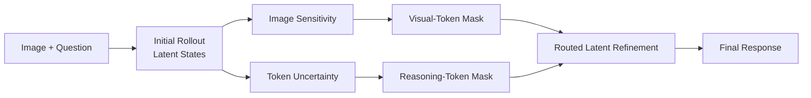

<div align="center">

# TD-LTTS

### Token-Disentangled Latent Test-Time Scaling for Vision-Language Reasoning

[](LICENSE)
[](https://www.python.org/)

</div>

TD-LTTS is a training-free inference-time refinement framework for multimodal
language models. Instead of applying one global objective to every editable
latent token, it assigns visual and reasoning feedback to different token
subsets and keeps the remaining representation anchored.

## Method

Given an image-question pair, TD-LTTS:

1. generates an initial response and records its hidden states;
2. identifies image-sensitive tokens for visual refinement;
3. identifies high-entropy tokens for reasoning refinement;
4. constructs disjoint top-k routing masks for the two branches;
5. optimizes the selected latent states with branch-specific rewards; and
6. decodes the refined states into the final response.



Unselected tokens are regularized toward their initial states. The default
strict router also prevents the visual and reasoning masks from overlapping.

## Default Configuration

The public launcher reproduces the final method configuration:

| Component | Default |
| --- | --- |
| Token router | `vppo_strict_topk` |
| Visual-token budget | `0.4` |
| Reasoning-token budget | `0.4` |
| Visual reward | `aver` |
| Visual reward temperature | `0.2` |
| Latent refinement steps | `4` |

Every setting can be overridden through launcher arguments or environment
variables; see `src/scripts/lib/experiment_config.sh` for the complete list.

## Supported Evaluation

**Model families**

- Qwen2.5-VL: 3B, 7B, and 32B
- Qwen3-VL-8B
- InternVL3-38B and InternVL3.5: 4B and 8B
- LLaVA-OneVision-1.5-8B
- MiMo-VL-7B

**Benchmarks**

| Focus | Benchmarks |
| --- | --- |
| Perception | MMStar, RealWorldQA, ScienceQA-IMG, HallusionBench |
| Reasoning | MathVista, LogicVista, MMMU |

## Installation

```bash
git clone https://github.com/Qwen-Applications/TD-LTTS.git
cd TD-LTTS

python -m venv .venv
source .venv/bin/activate
python -m pip install --upgrade pip
python -m pip install -r requirements.txt
```

Install the PyTorch build appropriate for your CUDA environment before the
remaining dependencies when a custom CUDA wheel is required.

## Model and Data Layout

By default, launchers resolve models from `./model` and datasets from
`./dataset`. The roots can be changed without editing source files:

```bash
export LATENT_TTS_MODEL_ROOT=/path/to/models
export LATENT_TTS_DATA_ROOT=/path/to/datasets
```

The default dataset directory names are:

```text
dataset/
|-- HallusionBench/
|-- LogicVista/
|-- MathVista/
|-- MMStar/
|-- MMMU-val-single-image/
|-- RealWorldQA/
`-- ScienceQA-IMG/
```

For MMMU, `src/scripts/prepare_mmmu_single_image_val.py` prepares the
single-image validation subset expected by the launcher.

## Quick Start

Inspect the exact command and shard ranges without loading a model:

```bash
bash src/scripts/launch_token_disentangle.sh \
  --benchmark mmstar \
  --model-family qwen25vl7b \
  --gpus 0,1,2,3,4,5,6,7 \
  --dry-run
```

Run a small single-process smoke test:

```bash
bash src/scripts/run_benchmark.sh \
  --benchmark mathvista \
  --model /path/to/Qwen2.5-VL-7B-Instruct \
  --data /path/to/MathVista \
  --end 3
```

Run the final method on all supported benchmarks with eight GPU shards:

```bash
export QWEN_MAX_PIXELS=1003520

bash src/scripts/launch_token_disentangle.sh \
  --benchmarks all \
  --model-family qwen25vl7b \
  --variant vppo_strict_topk \
  --visual-branch aver \
  --tau 0.2 \
  --gpus 0,1,2,3,4,5,6,7 \
  --wait
```

With `--wait`, each benchmark is aggregated after all shards complete and its
accuracy is printed to the terminal. Detailed outputs are written under
`result/suites/` by default.

## Ablations

The ablation launcher uses the same model, data, and sharding interface:

```bash
bash src/scripts/launch_ablation.sh \
  --benchmarks all \
  --ablation no_visual_branch \
  --model-family qwen25vl7b \
  --gpus 0,1,2,3,4,5,6,7 \
  --wait
```

Run `bash src/scripts/launch_ablation.sh --help` for the available routing and
branch ablations.

## Repository Structure

```text
src/
|-- benchmarks/          benchmark adapters and answer parsing
|-- data/                dataset loading and example preparation
|-- evaluation/          answer extraction, finalization, and scoring
|-- methods/
|   |-- baselines/       output-space and latent-refinement baselines
|   `-- latentgrad/      latent generation, routing, and optimization
|-- models/              model-family adapters
|-- prompts/             solver and reward prompt templates
|-- rewards/             visual and reasoning reward implementations
|-- scripts/             parameterized launch and aggregation utilities
`-- main.py              inference and evaluation entry point
```

## License

TD-LTTS is released under the [MIT License](LICENSE). The vendored
`latex2sympy` component retains its original MIT notice.
